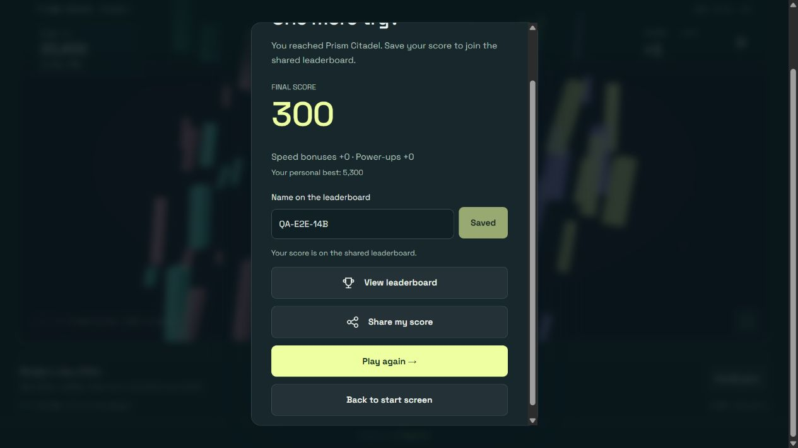

# Prism Breaker final acceptance check

Checked October 14, 2026. Live release: `ee6a8edb8f4578dd9b0b`.

## Result

The checked gameplay, submission, daily rollover, and expiry flows work. **101 automated tests pass, with zero failures.** No new blocking gameplay defect was observed. This is a scoped acceptance result, not a guarantee for every device or an unconditional production-readiness certification.

Two qualifications remain: newly published Pagelove policies can behave inconsistently during propagation, and physical score deletion is driven by board access rather than a scheduled five-day deletion job.

## What was checked

| Area | Method and result |
| --- | --- |
| Live release | Home returned HTTP 200. Seven runtime modules matched local SHA-256 hashes. PWA integrity check passed for 70 assets, 2,411,852 bytes. |
| All 16 worlds | Every published HTML world returned 200 and parsed successfully with its expected identity. All 20 formations were present. |
| Collision playability | Existing collision bot tests cleared every world using actual ball collisions. These tests replenish lives; they prove reachability and completion, not difficulty balance or a three-life human playthrough. |
| Browser campaign progression | A local harness using the production application traversed all 16 worlds and all 20 formations, prepared and rendered each ending, checked its story/next-world text, and reached the final Adventure result and champion scene. It accelerated destruction through the engine's damage method. No captured browser errors. |
| Actual live play | A normal live Daily Challenge run launched three balls, broke bricks, lost lives, and reached a 300-point result in Prism Citadel. No runtime error logs were captured. |
| Live browser submission | Normal name entry and Save score progressed from Queued to Saved. The 300-point run appeared on the actual Daily leaderboard at rank 7. Owner readback confirmed persistence and a server-assigned expiry approximately five days after submission. |
| Submission uniqueness | A separate zero-point QA POST persisted once; repeating its run key returned 422 and left one record. |
| Invalid submissions | A disposable copy of production score rules rejected a negative score and client-supplied `expiresAt` with 422. |
| UTC midnight rollover | A controlled browser clock crossed from October 14 to October 15. The visible Daily board changed from the previous day's row to the new day's row, and the next challenge changed to Thunder Spire. |
| Run spanning midnight | The in-progress run retained October 14, displayed the previous-day explanation, saved successfully, did not appear on October 15's board, and did not receive October 15's record celebration. |
| Five-day display expiry | Boundary tests retained a record at expiry minus 1 ms and removed it at expiry. In the browser, an open leaderboard removed an expiring leader automatically and promoted the active row. A cleanup request was emitted. |
| Five-day physical cleanup | On a disposable hosted board, a server-clock cutoff DELETE returned 204 and removed only the expired row. An independent GET-driven case returned both rows on the triggering read and only the active row on the next read. |
| Deletion protection | Once the disposable policy was observed active, unrestricted deletion and a future cutoff returned 403; both unexpired controls remained. |
| Age outline boundaries | Green through exactly 48 hours; yellow above 48 through 96 hours; red above 96 hours. Automated boundary checks passed. |

## Worlds and formations

The browser sequence covered Prism Garden, Cloud Carnival, Electric City, Crystal Caverns, Ember Foundry, Frost Observatory, Cosmic Reef, Prism Citadel, Sunken Archive, Aurora Passage, Clockwork Canopy, Mirage Dunes, Thunder Spire, Lunar Harbor, Event Horizon, and Dawn Nexus.

Prism Citadel and Dawn Nexus each completed formations 1, 2, and 3. The other fourteen worlds each completed one formation. World 7's ending was present and led to Prism Citadel; world 8 led to Sunken Archive; world 16 displayed “You brought the dawn.” and the final result.

## Findings and limits

### Expiry is access-driven

The game excludes expired entries from rankings at the five-day boundary. The open interface checks once per second, so visible removal can lag the calculated boundary by approximately a timer tick, subject to browser throttling. The server GET processor and the client's DELETE request physically remove expired entries when the board is accessed. If nobody accesses it, records can remain stored beyond five days. Strict background deletion at exactly five days is therefore **not implemented**.

The first raw response that triggers server cleanup can still contain the expired row; the game filters that response before displaying standings. The subsequent server read confirmed the row was physically gone.

### Fresh policy propagation remains a deployment concern

One early disposable-board attempt returned 204 for an unrestricted DELETE and removed an unexpired control; later requests rejected unsafe deletion. This happened immediately after introducing a new policy and is consistent with the separately measured policy-freshness issue, but the exact server cause is unconfirmed. It is a real failed observation and has not been discarded from the evidence.

A second readiness attempt used an empty container and received 416, which did not establish whether the guard ran. The final attempt populated controls, observed three consecutive 403 guard responses, and passed both unsafe-delete and expiry-delete checks. That establishes the tested settled behavior; it does not make policy propagation safe by itself or retroactively turn the failed attempt into a pass.

The workstation was approximately 2.8–3.6 seconds ahead of the server Date header during these probes. An initial cleanup probe used workstation time and received 403 because the cutoff could be in the server's future. The final probe used server time, matching the game's existing clock-offset approach. This probe error was not a newly discovered game bug.

### Minor copy issue

At one remaining life, the live game says “1 lives left. You've got this.” The accessibility label also uses “1 lives.” This is cosmetic and was not changed during this review.

### Coverage boundaries

Rollover and five-day age were tested with controlled timestamps; this review did not wait for a real midnight or five elapsed days. Cinematics were prepared/rendered and their camera calculations are covered by existing tests; every complete cinematic was not watched in real time. The sixteen-world browser campaign used accelerated damage; the actual live browser run was a normal losing Daily run. No new Android/iOS hardware sweep was performed.

The local fixture intercepts score requests and disables PWA registration to isolate it. Real hosted submission and expiry were tested separately, including the full live browser save flow. These distinct test boundaries are intentional and recorded rather than described as one unmodified sixteen-world live playthrough.

## Cleanup and source changes

Both production QA scores were removed with conditional ETag writes. Each cleanup confirmed all 68 other records were preserved. The live leaderboard was refreshed and the browser QA row was absent. Disposable documents returned 404 after deletion. No production gameplay code, world definitions, or permanent score policies were changed or deployed.

The test browser's remembered name was set to `QA-E2E-14B` by its normal Save score action; its local sent receipt remains a test-browser artifact. The local harness also has test-only preferences, results, and receipts. These are not player leaderboard entries.

Added three automated lifecycle tests and reusable acceptance scripts. Reviewable changes and hashes are recorded in the audit directory. No external issue, GitHub push, or release was performed for this check.

## Evidence

- [Live modules, world documents, submission, and cleanup](audit/2026-10-14-final-live-check.json)
- [All sixteen browser world endings](audit/2026-10-14-final-browser-worlds.json)
- [Browser midnight rollover](audit/2026-10-14-final-browser-rollover.json)
- [Browser visible expiry](audit/2026-10-14-final-browser-expiry.json)
- [Live browser score persistence and cleanup](audit/2026-10-14-final-browser-live-score.json)
- [Final isolated expiry checks](audit/2026-10-14-final-expiry-check.json)
- [Initial failed expiry observation](audit/2026-10-14-final-expiry-initial.json)
- [Inconclusive empty-container readiness check](audit/2026-10-14-final-expiry-empty-readiness.json)
- [Automated test output](audit/2026-10-14-final-test-output.txt)
- [Audit plan, revisions, and verification](audit/2026-10-14-final-acceptance.md)
- [Additional platform investigation findings](DAV-INVESTIGATION-FINDINGS.md)

